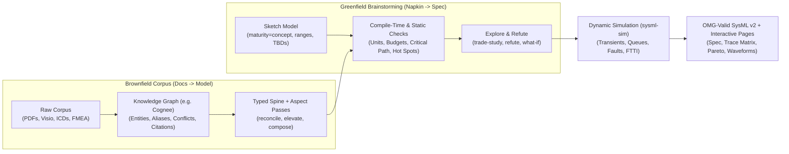

# `rsysdsl` Brainstorming Compiler — Architecture & Roadmap Plan

> **Vision:** Bring the sub-second *"try an idea → see what breaks → pivot"* loop of vibe coding — and the mathematical rigor of **Lean / Coq** — to **concept-phase systems engineering**. Catch bad, contradictory, or physically impossible requirements *before* the official spec is frozen, while still compiling cleanly to OMG-valid SysML v2.

---

## 1. The Core Idea: A "Lean for Systems Engineering"

Traditional MBSE tools (Cameo, Capella, Rhapsody) are **documentation cemeteries**: engineers use them *after* the design is finished because authoring is slow and the tool cannot tell you whether your system actually fits its physics, latency, thermal, or cost envelopes.

`rsysdsl` already has the foundations of a **formal systems compiler**:
- Strongly typed Rust (`rustc`) checking port polarity, specializations, and state targets at compile time.
- Compile-time SI dimensional analysis (`crates/sysml-core/src/units.rs` + `units_check.rs`).
- Explicit uncertainty (`#[sysml::tbd]`, `tbd_value`, `--maturity concept..release`).
- First-class product-line variants (`#[sysml::variation]`), executable constraints (`EvaluableRequirement`), pure formulas (`#[sysml::calc]`), and deterministic RK4 simulation (`sysml-sim`) with interactive HTML trace playback.

The next leap is turning `rsysdsl` into a **Brainstorming Compiler** that unifies two workflows into one lifecycle:



---

## 2. Three Verification Tiers: What Runs at Compile Time vs. Static Graph vs. Simulation?

A key design question is **where** each budget, critical path, and hot spot should be checked. Putting everything in `rustc` would be slow or impossible for coupled ODEs; putting everything in dynamic sim loses instant feedback. The right split has **three clean tiers**:

| Check / Budget | Tier 1: `rustc` Compile-Time (`const` / proc-macro) | Tier 2: Static IR Analyzer (`rsysdsl budget / refute / trade-study`, <1 s) | Tier 3: Dynamic Simulation (`sysml-sim`, RK4 / discrete-event) |
| --- | --- | --- | --- |
| **Dimensional / Unit Safety** | **Yes** (`W`, `s`, `Hz`, `bit/s`, `K`, `kg`, `USD`) | — | — |
| **Static Additive Budgets** (Mass, BOM Cost, Peak Power, Steady Waste Heat) | **Yes** (simple `const` rollups on a single config) | **Yes** (full tree rollup + **Hot Spot % ranking** + supply vs demand margin) | Transient peaks (duty cycles, startup surges, battery SOC) |
| **Response Time / Latency & LLM "Thinking" Budget** | Single-hop / local bounds | **Yes — Critical Path (DAG longest path)** across `Sensor → Preprocess → LLM → Actuator`, flagging bottleneck stage | Queuing jitter, variable LLM TTFT / token-length bursts, retries, preemption |
| **FPS / Frame-Rate & Pipeline Throughput** | Local rate compatibility | **Yes — Bottleneck Stage** (`min_i(1 / stage_time_i)` vs required FPS; flags stage limiting FPS) | Backpressure, dropped frames, buffer overflow under bursty input |
| **Input / Bus Bandwidth Budget** | Port payload typing | **Yes — Channel Utilization** (`sum(stream_rate * payload_bits) <= bus_capacity_bps` per interface/bus; hot-link detection) | Packet collisions, CAN arbitration, DMA contention |
| **Heat Dispersal (Thermal)** | Steady-state conductance check | **Yes — Steady-State Thermal Network** (`T_j = T_amb + P_loss / G_th <= T_max`; thermal hot spots) | Thermal inertia (`C dT/dt`), fan ramp-up, thermal throttling, ambient swings |
| **Requirement Refutation (Contradictions)** | Trivial constant contradictions | **Yes — Feasibility & Minimal Unsatisfiable Core** across variants & parameter ranges | Dynamic FTTI / safety-goal violations under `@FMEA` fault injection |

> **Rule of thumb:**
> - **Tier 1 (`rustc`)** catches *structural and dimensional nonsense* on every keystroke.
> - **Tier 2 (Static IR Operators)** computes **budgets, critical paths, hot spots, Pareto frontiers, and requirement refutations** in **< 1 second** with zero simulation code to write.
> - **Tier 3 (`sysml-sim`)** proves **time-varying physics, queues, state-machine dynamics, and fault tolerance**.

---

## 3. Universal Cross-Domain Budgets (Including Cyber-Physical & AI/LLM Systems)

Every modern system — whether a dishwasher, a drone, or an edge-AI / robotics agent — lives inside **coupled budgets**. We can model all of them uniformly in `sysml-std` using standard attributes + typed `#[sysml::budget]` or `#[sysml::flow]` annotations:

### 3.1 The 8 Core Budgets & How Each Rolls Up

| Budget Domain | Model Attributes (on parts / actions / channels) | Static Rollup & Bottleneck Formula | Hot-Spot Metric |
| --- | --- | --- | --- |
| **1. Response Time (Latency)** | `latency_ms` / `wcet_s` on actions/parts, `prop_delay_s` on channels | **Critical Path** = longest weighted path in the `connect` / `perform` DAG: $\max_{p \in \text{paths}} \sum_{v \in p} t_v \le T_{\text{deadline}}$ | Top-3 stages by % of critical path |
| **2. LLM / AI "Thinking" Time** | `ttft_s` (time-to-first-token), `tokens_out`, `tok_per_s` (or `inference_s`), `context_tokens` | `t_llm = ttft_s + tokens_out / tok_per_s` (plugs directly into the Latency Critical Path!) + `tokens_in + tokens_out <= context_window` | % of end-to-end latency spent in LLM vs sensor/IO |
| **3. FPS / Throughput** | `stage_period_s` (or `max_fps`) per pipeline stage, `parallelism` | **Pipeline FPS** = $\min_i \left(\frac{\text{parallelism}_i}{\text{stage\_time}_i}\right) \ge \text{FPS}_{\text{req}}$ | Bottleneck stage (lowest max FPS; utilization $\ge 85\%$) |
| **4. Input / Bus Bandwidth** | `sample_rate_hz`, `payload_bits` on flows; `capacity_bps` on `CommChannel` | Per channel $c$: $\sum_{f \in c} (\text{rate}_f \cdot \text{bits}_f) \le \eta_{\max} \cdot \text{capacity}_c$ | Links with utilization $> 70\%$ |
| **5. Power & Energy** | `rated_power_w`, `standby_power_w`, `efficiency`, `energy_capacity_j` | Demand $\sum P_i \le P_{\text{supply}}$; runtime $E_{\text{batt}} / P_{\text{total}} \ge T_{\text{mission}}$ | Top-3 power consumers (% of rail) |
| **6. Heat Dispersal (Thermal)** | `efficiency` ($\Rightarrow P_{\text{heat}} = P_{\text{in}}(1-\eta)$), `thermal_conductance_w_per_k`, `max_temp_k` | Zone heat load $\sum P_{\text{heat}, i} \le G_{\text{sink}} (T_{\max} - T_{\text{amb}})$ | Highest $\Delta T$ / smallest thermal margin (K) |
| **7. Mass & Volume** | `mass_kg`, `volume_l` | $\sum m_i \le M_{\max}$ | Heaviest subsystems (% of total mass) |
| **8. BOM Cost** | `unit_cost_usd` (or `cost_range = 12.0..18.0` in concept mode) | $\sum c_i \le C_{\max}$ | Top-3 cost drivers (% of BOM) |

### 3.2 Example: Concept-Phase Edge-AI Robot / Smart Camera Sketch

```rust
// Every stage declares its timing, power, and cost in idiomatic Rust:
#[sysml::part]
#[sysml::specializes(ComputeNode)]
pub struct EdgeLlmAccelerator {
    #[sysml::attr(default = 0.120, unit = "s")]   pub ttft: Quantity<f64>,
    #[sysml::attr(dimensionless, default = 40.0)] pub tokens_out: f64,
    #[sysml::attr(default = 80.0, unit = "Hz")]   pub tok_per_s: Quantity<f64>, // 0.50 s decode -> 0.62 s total
    #[sysml::attr(default = 25.0, unit = "W")]    pub rated_power: Quantity<f64>,
    #[sysml::attr(default = 0.08, unit = "kg")]   pub mass: Quantity<f64>,
    #[sysml::attr(custom_unit = "BOM currency", unit = "USD", default = 149.0)]
    pub unit_cost: Quantity<f64>,
}
```

Running `rsysdsl budget --model smart_robot` immediately outputs (in < 1 s, **before writing a single sim**):
- **Critical Path (`camera -> preprocess -> llm -> motor_ctrl`):** `16 ms + 8 ms + 620 ms + 5 ms = 649 ms` vs `500 ms` budget → **FAIL (margin = -149 ms)**.
- **Hot Spot:** `EdgeLlmAccelerator` accounts for **95.5%** of critical-path latency (120 ms TTFT + 500 ms decode).
- **Pipeline FPS:** Bottlenecked at `EdgeLlmAccelerator` (`1.61 FPS` vs `2.0 FPS` req) — camera (`60 FPS`) is over-provisioned; camera link bandwidth is `1.49 Gbps` on a `1.0 Gbps` Ethernet channel → **FAIL (149% link utilization)**.
- **Thermal:** `25 W` in enclosure with `0.6 W/K` conductance → `ΔT = 41.7 K` (margin `+3.3 K` — **thermal hot spot warning**).

---

## 4. The Brainstorming Compiler Operator Suite

### 4.1 Concept & Analysis Operators (Greenfield + Brownfield)

1. **`rsysdsl budget`** — *Cross-Domain Rollup, Critical Path & Hot-Spot Detector*
   - Walks the compiled IR (`Model`):
     - Hierarchical sums for Mass, Cost, Power, Heat.
     - Directed graph longest-path (**Critical Path**) over connected ports/actions for end-to-end Latency & LLM thinking time.
     - Bottleneck stage calculation for **FPS / Throughput** and per-channel utilization for **Bandwidth**.
     - Emits a structured JSON + Markdown report + **Hot-Spot Heatmap** overlay for `rsysdsl view` (nodes/arrows colored by % of budget consumed!).

2. **`rsysdsl trade-study`** — *Automatic `#[sysml::variation]` Pareto Explorer*
   - Enumerates the Cartesian product of all `#[sysml::variation]` enums in a model (e.g., `BatteryVariant × ComputeVariant × CoolingVariant`).
   - Runs `budget` + `EvaluableRequirement::evaluate()` (and optionally `sysml-sim` scenarios) on every combination.
   - Outputs a **Pareto frontier** table + interactive HTML scatter plot (e.g., Cost vs. Latency vs. Mass vs. Runtime, highlighting dominated vs. feasible vs. infeasible variants).

3. **`rsysdsl refute`** — *Requirement Contradiction & Feasibility Prover*
   - Given a set of `#[sysml::requirement]` constraints, `#[sysml::calc]` laws, and parameter ranges (`estimate = min..max` or `#[sysml::variation]` options):
     - Checks whether *any* assignment satisfies all requirements simultaneously.
     - If **UNSAT**, computes a **Minimal Unsatisfiable Core** and **minimum relaxation** (*"No variant satisfies `REQ-LATENCY <= 500 ms` + `REQ-COST <= $150` + `REQ-TOKENS >= 40`. Relaxing `REQ-TOKENS` to `<= 30` or upgrading to `AcceleratorPro` (+$90) restores feasibility."*).
   - Starts with deterministic grid/interval search over Rust closures (zero external solver dependency); optional SMT (Z3) backend later for symbolic proofs.

4. **`rsysdsl what-if`** — *Sensitivity & Tornado Ranking ("Which TBD Matters Most?")*
   - Perturbs every numeric parameter (especially `estimate = lo..hi` ranges and ±10% tolerances) and measures `d(margin) / d(param)` for each requirement.
   - Produces a **Tornado chart** ranking which assumptions/TBDs have the largest risk of flipping a requirement from PASS to FAIL — telling the engineer *what to research first*.

5. **`rsysdsl watch`** — *Live "Vibe Coding" Feedback Loop*
   - Watches `src/`, rebuilds on save, re-runs `budget` + `audit` + selected fast sim, and live-reloads the browser with **IBD (hot-spot colored) + Budget Bars + Pareto Frontier + Sim Waveforms** side by side.

### 4.2 Corpus & Refactoring Operators (Brownfield Docs → Clean Model)

6. **`rsysdsl reconcile`** — *Alias & Conflict Registry (KG → Typed Spine)*
   - Ingests an entity/alias/claim table (e.g., exported from a **Cognee / `cppognee`** Knowledge Graph over a 50-doc PDF/Visio/Excel corpus).
   - Maps inconsistent doc terms (`"U2"`, `"Main Controller"`, `"Safety MCU"`) to one canonical `rsysdsl` type with full `(doc, section, page)` provenance.
   - Automatically turns cross-document numerical conflicts (*"Spec A: 20 ms vs ICD Rev 2: 50 ms"*) into `#[sysml::tbd(reason = "conflict: ...")]` instead of silently guessing.

7. **`rsysdsl elevate`** — *Generalize & Refactor to Abstract Bases*
   - Builds directly on `rsysdsl lint`'s `duplicate_part_shape` detector: computes the structural intersection of sibling parts or ad-hoc links, checks for matching `sysml-std` bases, and proposes an `#[sysml::part(abstract)]` parent + `#[sysml::specializes]` / `:>>` redefinitions.

8. **`rsysdsl slice`** — *Aspect Viewpoint Projection*
   - Projects a unified multi-domain model onto a single aspect (`--aspect thermal | power | latency | comms | safety`) for clean `rsysdsl view` diagrams and focused reviews.

---

## 5. DSL & `sysml-std` Additions Needed (Minimal & Idiomatic)

To keep the Rust DSL clean and avoid bloat, we only need **3 small, orthogonal additions**:

1. **Concept-phase uncertainty ranges** (extends S7 `tbd_value`):
   ```rust
   #[sysml::attr(unit = "W", estimate = 18.0..30.0)] // valid at --maturity concept/preliminary; must be narrowed by release
   pub rated_power: Quantity<f64>,
   ```
   - Compiles with midpoint default for quick checks, while `budget` / `what-if` / `refute` automatically sweep `[18.0, 30.0]` (best / nominal / worst case).

2. **Cyber-Physical & AI flow/timing bases in `sysml-std`**:
   - Extend `crates/sysml-std/src/comms.rs` & `electronics.rs` with abstract bases:
     - `ComputeStage` (`latency`, `max_fps`, `rated_power`, `efficiency`)
     - `LlmInferenceStage` (`ttft`, `tokens_out`, `tok_per_s`, `context_window`)
     - `BandwidthChannel` (`capacity_bps`, `prop_delay_s`)
     - `DataStreamFlow` (`sample_rate_hz`, `payload_bits`)
   - Add standard `#[sysml::calc]` helpers: `llm_latency_s(ttft, tokens, tok_per_s)`, `stream_bandwidth_bps(rate_hz, bits)`, `pipeline_fps(stage_time_s)`.

3. **Static Critical-Path & Budget Graph in `crates/sysml-emit/src/budget.rs`** (pure IR pass, no heavy deps):
   - Builds the directed port/connection graph from `Model`.
   - Runs topological longest-path (DAG critical path) + recursive tree rollups + hot-spot % attribution.
   - Feeds directly into `rsysdsl view --heatmap latency|power|thermal|cost|bandwidth`.

---

## 6. Phased Implementation Plan (For Next Week)

| Phase | Deliverable | Scope & Verification | Est. Effort |
| --- | --- | --- | --- |
| **B1 — Static Budgets, Critical Path & Hot Spots** | `crates/sysml-emit/src/budget.rs` + `rsysdsl budget` CLI + `sysml-std` AI/latency/bandwidth bases + 1 reference example (`edge_ai_robot` or `smart_camera`) | Rollups (mass, power, heat, cost), DAG critical path (latency + LLM thinking time), bottleneck FPS, channel bandwidth utilization, top-3 hot spots. Unit + CLI E2E tests. | ~1–1.5 days |
| **B2 — `trade-study` & `what-if` Sensitivity** | `rsysdsl trade-study` (variation Cartesian sweep + Pareto frontier) & `rsysdsl what-if` (Tornado margin sensitivity) + interactive HTML Pareto/Tornado tab in `rsysdsl view` | Demonstrated on `power_tools_family` (2Ah vs 5Ah × 3 tools) and `edge_ai_robot`. Published to GitHub Pages. | ~1–1.5 days |
| **B3 — `refute` (Requirement Contradiction Prover)** | `estimate = lo..hi` attribute range + `rsysdsl refute` (feasibility check, Minimal Unsatisfiable Core, minimum relaxation suggestions) | Proves contradictory reqs UNSAT on test fixtures & `edge_ai_robot`; suggests exact relaxation to restore feasibility. | ~1 day |
| **B4 — Visual Heatmap & `rsysdsl watch`** | `rsysdsl view --heatmap <domain>` (colors IBD boxes/arrows by budget utilization & critical path) + `rsysdsl watch` live reload | Playwright smoke test verifies heatmap rendering on GitHub Pages showcase. | ~1 day |
| **B5 — Corpus-to-Model Pilot (`reconcile` + `elevate` + `slice`)** | End-to-end pilot using `cppognee` KG over a real multi-doc public spec → alias/conflict table → Typed Spine + Aspect Passes → `rsysdsl budget/refute` | Proves both greenfield brainstorming and brownfield corpus ingestion share the exact same compiler core. | ~1.5–2 days |

---

## 7. Open Questions to Discuss Before Building B1

1. **First showcase system for B1:** Would you like to test the full budget suite (FPS + input bandwidth + LLM thinking time + power + heat + cost) on an **Edge-AI Drone / Smart Camera** example, or add budgets to an existing example (like `dishwasher` / `power_tools_family`) first?
2. **Compile-time `const` vs. `rsysdsl budget`:** Should failing a budget be a **Rust compile error** (via `const` / unit test), a **`rsysdsl budget --strict` CI gate**, or configurable by `--maturity` (warnings in `concept`, hard errors in `detailed`/`release`)? *(Recommended: warning/info in `concept` so brainstorming stays fluid, hard error in `--strict` / `detailed`+.)*
3. **Cost & custom units:** Keep `USD` via `custom_unit` (already supported cleanly in `CustomUnitMetadata` after PR #7) or add a lightweight `SysmlStdEconomics` package?
