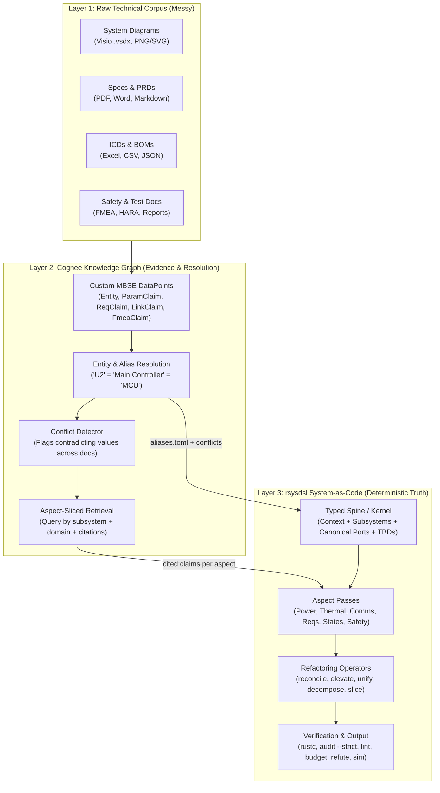

# Building System Models from Large Documentation Corpora (`Cognee` + `rsysdsl` Refactoring Operators)

> **Companion to:** [`docs/BRAINSTORMING_COMPILER_PLAN.md`](BRAINSTORMING_COMPILER_PLAN.md)
> **Goal:** Turn messy, multi-document engineering corpora (10–500+ PDFs, Visio diagrams, Excel ICDs, requirements sheets, FMEA tables, ECOs) into clean, hierarchical, compiler-checked `rsysdsl` models — with **zero invented numbers**, **full document provenance**, **automatic conflict surfacing**, and **software-grade refactoring operators**.

---

## 1. Why a 3-Layer Pipeline Beats Raw LLM Prompting

Stuffing 50 technical documents directly into an LLM to generate a SysML model fails in predictable ways:
- **Context overflow & hallucination:** Agents lose track of earlier docs and silently invent missing values or drop constraints.
- **Terminology drift:** The electrical schematic calls it `U2 / PWR_BRD`, the thermal spec calls it `Main Controller`, the safety doc calls it `Safety MCU`, and the PRD calls it `The Control Unit`.
- **Silent conflict resolution:** When Spec Rev 1 says `cutoff <= 20 ms` and ICD Rev 2 says `50 ms`, an LLM quietly picks one without telling the engineer.
- **Flat, copy-paste models:** Direct doc-to-code translation produces flat 40-part "God assemblies" with duplicated attributes instead of clean inheritance hierarchies.

Separating **probabilistic extraction** (`Cognee` / `cppognee`) from **deterministic formal modeling** (`rsysdsl`) solves all four:

---

## 2. Layer 2: Cognee (`cppognee`) Knowledge Graph Schema for MBSE

Rather than using generic prose chunks, we define a small, typed Cognee `graph_model` (using `DataPoint` classes with identity fields so mentions merge across documents):

| `DataPoint` Node | Key Fields | Purpose |
| --- | --- | --- |
| `DocSource` | `doc_id`, `title`, `revision`, `date`, `path` | Tracks exact document version for provenance and `diff-corpus`. |
| `CanonicalComponent` | `canonical_name`, `aliases: list[str]`, `domain`, `parent_hint` | Unifies inconsistent names across docs (`"U2"`, `"MCU"`, `"Control Board"`). |
| `ParameterClaim` | `component`, `param_name`, `value`, `unit`, `condition`, `source_ref` | Every number stays tied to `(doc_id, section, page, verbatim quote)`. |
| `InterfaceClaim` | `from_component`, `to_component`, `payload`, `protocol`, `rate_or_power`, `source_ref` | Captures arrows from Visio diagrams, wiring harnesses, and ICD tables. |
| `RequirementClaim` | `req_id`, `text`, `metric`, `operator`, `limit_value`, `unit`, `target_component`, `source_ref` | Feeds `#[sysml::requirement]` + `#[sysml::require_constraint]` + `#[sysml::rationale]`. |
| `BehaviorClaim` | `component`, `state_from`, `state_to`, `trigger`, `guard`, `source_ref` | Feeds `#[sysml::state]` and `#[sysml::transition]`. |
| `FmeaClaim` | `component`, `failure_mode`, `effect`, `severity`, `occurrence`, `detection`, `source_ref` | Feeds `#[sysml::fmea(...)]` and `sysml-sim` fault injection. |
| `ConflictRecord` | `subject`, `claim_a`, `claim_b`, `conflict_kind` | Explicit record whenever two docs disagree on a value, unit, or connection. |

**Key invariant:** The Knowledge Graph is **read-only evidence**; `rsysdsl` is the **formal source of truth**. Every non-TBD value in `rsysdsl` must trace back to a `source_ref` in the KG, and every `ConflictRecord` becomes an explicit `#[sysml::tbd(reason = "conflict: ...")]`.

---

## 3. Layer 3 Workflow: Typed Spine + Aspect Passes

We deliberately avoid building disconnected per-document models and trying to fuzzy-merge them later. Instead, we build **one compiling Spine** and enrich it in **bounded, aspect-sliced passes**:

1. **Pass 0 — Ingest & Reconcile (Cognee → `aliases.toml` + `conflicts.json`):**
   - Ingest all corpus docs into a dedicated Cognee dataset.
   - Cluster component aliases, normalize units, and export the **Canonical Component Table** and **Conflict Report**.
2. **Pass 1 — Typed Spine (Kernel):**
   - From the highest-level block diagram + Canonical Component Table, scaffold the crate (`rsysdsl new <system>`).
   - Author the top-level `Context`, major `Subsystems`, and canonical ports (inheriting from `sysml-std`).
   - Unknown protocols use `#[sysml::connect(tbd = "protocol not in overview diagram")]`; unknown values use `tbd_value`.
   - **Gate:** `cargo test` + `rsysdsl audit --stdlib --strict --maturity concept` → 0 errors, 0 warnings.
3. **Pass 2..N — Aspect Passes (One Domain at a Time):**
   - Query Cognee for **one aspect + one subsystem** (e.g., *"all thermal claims & requirements for `PowerSubsystem`"*).
   - Attach attributes, typed interfaces, requirements (with `#[sysml::rationale("Source: <doc> §<sec>")]`), state machines, and FMEA entries directly onto the Spine.
   - `rustc` immediately rejects broken field paths, mismatched port polarities, and unit errors.
4. **Pass N+1 — Refactor, Harmonize & Verify:**
   - Run the **Refactoring Operators** below (`elevate`, `decompose`, `unify`, `slice`) + `rsysdsl lint --strict` + `rsysdsl budget` / `refute` / `sysml-sim`.

---

## 4. The Refactoring & Harmonization Operator Suite

Just as IDEs give software engineers structured refactorings (`Extract Superclass`, `Rename Symbol`, `Extract Module`), `rsysdsl` needs **6 domain-specific model operators** operating over the `sysml-ir::Model` + KG metadata:

### 4.1 `reconcile` — Alias & Conflict Reconciliation
- **Input:** Cognee KG export (`claims.json`) + existing `aliases.toml` + current `rsysdsl` model.
- **What it does:**
  - Proposes alias merges when two differently named entities share ports, neighbors, or high embedding/lexical similarity (e.g. `MotorDriverBoard` ≈ `InverterStage` ≈ `DRV_MOD`).
  - Maps all doc mentions to one canonical Rust struct name and records aliases in `aliases.toml` (checked into git so future re-ingests are deterministic).
  - Flags **value/unit conflicts** across docs and generates `#[sysml::tbd(reason = "conflict: Doc A (20 ms) vs Doc B (50 ms)")]`.
  - Audits **provenance coverage**: flags any literal number in `rsysdsl` that lacks a KG citation or explicit `tbd_value`.

### 4.2 `elevate` — Find Common Structure & Lift to Abstract Base
- **Input:** Compiled `rsysdsl` IR (`Model`) + `sysml-std` library.
- **What it does:**
  - Extends `rsysdsl lint`'s existing `duplicate_part_shape` detector into an actionable refactoring operator:
    1. Computes the **structural intersection** (shared attributes, units, ports) of sibling parts (e.g., `PrimaryDoorInterlock`, `MonitorDoorInterlock`, `LidLatchSwitch`).
    2. Checks whether an existing `sysml-std` base (`SafetyInterlock`, `ElectricMotor`, `CommChannel`, etc.) already covers >= 70% of that intersection.
    3. Emits a refactoring plan (and optional Rust patch) creating an `#[sysml::part(abstract)]` base (or specializing `sysml-std`), rewriting children to `#[sysml::specializes(Base)]` with `:>>` redefinitions, and suggesting a `#[sysml::variation(of = Base)]` enum when they are mutually exclusive options.
  - Same for **interfaces/channels**: detects repeated ad-hoc port connections and elevates them into a shared abstract `Channel` / `sysml-std` interface.

### 4.3 `unify` / `merge-check` — Safe Model & Element Merging
- **Input:** Two `rsysdsl` models/packages (or two candidate elements within one model).
- **What it does:**
  - **Intra-model element merge:** Given a confirmed alias pair `(PartA, PartB)` created accidentally from two docs, computes the union of their ports/attributes/satisfies, flags any conflicting defaults as TBDs, and rewrites all `#[sysml::connect]` / `#[sysml::satisfy]` references to the unified canonical part.
  - **Inter-model subsystem composition (`merge-check`):** When integrating two team/supplier crates (e.g., `battery_pack` + `vehicle_chassis`), checks for requirement ID collisions, duplicate type names, compatible conjugated port pairs ready to connect, and shared-unit mismatches — *never* silently overwriting internals.

### 4.4 `decompose` — Break Flat "God Assemblies" into Domain Subsystems
- **Input:** A part with >10 direct child parts (already flagged by `rsysdsl lint` `flat_assembly`).
- **What it does:**
  - Clusters child parts by `sysml-std` domain (`Power`, `Electronics`, `Mechanics`, `Thermal`, `HMI`) and internal connection density (graph modularity / min-cut).
  - Proposes intermediate subsystem structs (`PowerSubsystem`, `ControlSubsystem`, ...) and computes the exact boundary ports needed to keep all external connections compiling.

### 4.5 `slice` — Aspect Viewpoint Projection
- **Input:** Unified `rsysdsl` model + `--aspect thermal | power | comms | safety | latency`.
- **What it does:**
  - Projects the full model onto only the parts, ports, connections, requirements, and calcs relevant to the requested domain.
  - Feeds `rsysdsl view --aspect thermal` so engineers inspect clean, uncluttered domain diagrams without maintaining separate siloed models.

### 4.6 `diff-corpus` — Incremental Spec Revision Sync
- **Input:** Updated document revision (e.g., `ICD_v3.pdf` replacing `ICD_v2.pdf`) ingested into Cognee.
- **What it does:**
  - Diffs the new KG claims against the `rsysdsl` model's cited values & constraints.
  - Outputs an **Impact Report**: which attributes changed, which requirements now fail `budget` / `sysml-sim`, which TBDs were resolved by the new revision, and which new conflicts appeared.

---

## 5. Phased Implementation Plan (For Next Week+)

| Phase | Deliverable | Scope & Verification | Est. Effort |
| --- | --- | --- | --- |
| **C1 — `elevate` & `slice` on Pure `rsysdsl` IR** | `crates/sysml-emit/src/refactor.rs` + `rsysdsl elevate` (JSON/Markdown refactoring plan) + `rsysdsl view --aspect <domain>` | Works standalone with zero external deps; tested on existing examples + synthetic flat/duplicated fixtures. | ~1–1.5 days |
| **C2 — `unify` / `merge-check` Operator** | `rsysdsl merge-check <modelA> <modelB>` + intra-model element-merge analyzer | Detects ID/name collisions, conflicting defaults, and candidate conjugated port pairs across crates. | ~1 day |
| **C3 — Cognee MBSE Schema & `reconcile` Bridge** | Small Python tool in `tools/corpus_kg/` (using `cppognee`) defining the 8 MBSE `DataPoint`s + exporting `claims.json`, `aliases.toml`, `conflicts.json`; `rsysdsl reconcile` consumes it | Tested on a real multi-doc public technical corpus (e.g., open-source PX4/drone or EV charger spec + schematic + FMEA). | ~1.5–2 days |
| **C4 — End-to-End Pilot (Corpus → KG → Spine → Refactored Model → Verified Sim)** | Full worked example in `examples/` showing raw docs → Cognee KG → Spine + Aspect passes → `elevate` / `decompose` → `audit --strict` + `lint --strict` + `budget` + `sysml-sim` | Proves zero invented numbers, 100% provenance, and conflicts captured as explicit TBDs. | ~1.5–2 days |
| **C5 — `diff-corpus` Incremental Revision Sync** | Re-ingest a modified spec rev into Cognee and generate a structured impact report against the `rsysdsl` model | Proves living-spec maintenance as requirements evolve. | ~1 day |

---

## 6. Open Questions to Discuss Next Week

1. **Which real public corpus should we use for the C3/C4 pilot?** Good candidates:
   - An open-source hardware system with rich docs (e.g., **PX4 / Pixhawk flight controller**, **OpenEVSE EV charger**, or **Prusa / Voron 3D printer** — schematics, BOM, firmware state machines, thermal/safety specs).
   - Or a **domain-specific corpus you already have in mind**?
2. **Patch generation vs. advisory plans for `elevate` / `decompose`:** Should `rsysdsl elevate` start by emitting a **structured JSON/Markdown refactoring plan** (which an agent or engineer applies cleanly to Rust source) before attempting automated Rust AST rewriting? *(Recommended: structured IR plan first — simpler, zero formatting breakage, pairs naturally with coding agents.)*
3. **Where should the Cognee bridge live?** Inside `rsysdsl/tools/corpus_kg/` (importing `cognee` from `cppognee`) or as a standalone integration repo/package connecting `cppognee` and `rsysdsl`?
